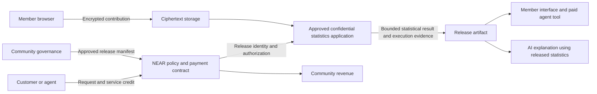

# COMMONS private intelligence owned by communities

Research recommendation dated 22 October 2026. Product development is reserved for the 1–14 November hackathon window. COMMONS is a working name, not a cleared brand.

**Build a community-owned service that answers useful questions about pooled sensitive data without giving buyers the individual records. Start with independent workers learning what they actually earn after fees, unpaid time, and expenses.**

A worker gets useful benchmarks. Their community controls the permitted analyses and receives service revenue. An AI agent can purchase an approved statistical answer, but cannot purchase a person's payslip. The longer-term contribution to NEAR is an open standard and reference implementation for selling bounded access to private collective knowledge.

## The first problem

Imagine a freelance designer deciding whether to accept a project. The advertised hourly rate ignores revisions, platform fees, and unpaid client acquisition. Other designers have relevant experience, but sharing a public spreadsheet could expose their earnings and clients.

COMMONS lets a defined community contribute a small structured record privately. It returns a distribution of effective earnings, with uncertainty and an explanation of what was counted. A member can compare an offer against that distribution without seeing another member's records. A community representative can use the same evidence to identify recurring problems and decide what to investigate.

This is a hypothetical user story, not an acquired customer. We begin with one kind of independent work and one comparable rate definition. Combining different occupations, countries, currencies, or periods would produce misleading comparisons.

The underlying information friction is documented. A field experiment with 755 bank employees found reluctance both to reveal and to ask about compensation; this is evidence of a salary-information problem, not direct validation of our freelancer product. An ILO study describes platform workers organizing to exchange information and address working conditions. [Salary Taboo research](https://www.nber.org/papers/w25145), [ILO platform work study](https://webapps.ilo.org/static/english/intserv/working-papers/wp080/index.html).

The product's first adoption hypothesis is specific: an existing freelancer association or community will collect better earnings evidence if it can offer members a useful comparison without giving its administrator a readable earnings database. That needs a pilot, not a market-size slide.

## What a person would do

1. Join a particular community pool. See exactly which fields are collected, the approved output, the retention period, and who receives revenue.
2. Enter a short work-period summary: gross receipts, fees, expenses, and total hours including unpaid time. Client names, invoice attachments, and precise locations are unnecessary for the first product.
3. Encrypt the contribution in the browser for the approved computation. The ordinary application server stores ciphertext.
4. Receive the community's approved benchmark, including its sampling limitations and privacy-related uncertainty.
5. Review the community's permission and revenue history. Withdraw from future collection and future releases under the published policy.

Initial records are explicitly **self-reported**. A confidential processor does not authenticate an uploaded PDF, certify a wage claim, or prove that a wallet is a unique person. A community can curate membership; that is an explicit admission policy rather than universal proof of personhood.

## The distinctive mechanism

COMMONS combines three controls: contributors approve a limited statistical release; the approved application computes it confidentially; and a shared NEAR contract records that release and its economics across every participating client.

The security objective is broader than keeping storage encrypted. An adversary can learn about someone by comparing many aggregates, even when every computation runs inside a trusted execution environment. Differential privacy limits the additional information a release reveals about an individual's contribution. A privacy budget accounts for the combined effect of releases. [NIST guidance](https://csrc.nist.gov/pubs/sp/800/226/final).

For COMMONS, this accounting belongs to the protected cohort and its release lineage. It does not reset when a buyer changes wallets, an operator restarts a worker, or a new frontend calls the service. Buying more access must not buy an unapproved relaxation of contributor privacy.

**The proposed contribution is a usable, community-governed release protocol with explicit accounting and payment behavior, demonstrated in a real worker problem.** Differential privacy, data cooperatives, confidential computation, and blockchain privacy accounting all have prior work. We should credit that work and measure the implementation against it.

## Why NEAR is useful

| NEAR component | Its proposed responsibility | Why this matters |
| --- | --- | --- |
| A small NEAR contract | Register a cohort's approved manifest and release IDs; prevent duplicate economic settlement; hold customer credit and record payment outcomes | Different agents and frontends share the same policy and payment state |
| OutLayer confidential execution | Run the pinned statistical application; decrypt only inside the approved environment; return an execution record | The application operator need not hold a readable pool of member records |
| OutLayer key binding | Restrict the relevant decryption secrets to the approved binary and caller context | A new application version must not silently inherit access to old contributions |
| Sputnik DAO, with existing treasury tooling where suitable | Approve the pool's allowed release and destination of revenue | Members control a useful resource and its proceeds without us rebuilding a multisig |
| NEAR AI Cloud | Explain only the released statistics and their limitations | Members can ask ordinary questions without giving an LLM unrestricted access to raw records |
| NEAR Intents, later | Accept a supported asset from a customer on another chain | Customers need not acquire NEAR just to pay for a service |

These are integration choices, not completed integrations. OutLayer documents execution evidence and binary-specific secret restrictions; an attestation identifies the execution, not the correctness of the statistical method. Its HTTP compute API documents a testnet endpoint. [Execution evidence](https://app.outlayer.ai/docs/tee-attestation), [secret binding](https://app.outlayer.ai/docs/secrets), [HTTP compute API](https://app.outlayer.ai/docs/https-api).

NEAR is useful because governance, approved use, and money must remain consistent across independently operated clients. One organization running an internal survey could use a conventional database. The case for a shared ledger becomes stronger when a community wants several applications and operators to work under the same public commitments. NEAR is a coherent fit; it is not the only chain that could support the design.

Function-call keys can give an agent access to narrowly selected contract methods. Their allowance limits gas spending; the contract must enforce the customer's monetary credit and permitted operations. Public view calls do not require a special read-only access key. [NEAR access keys](https://docs.near.org/protocol/accounts-contracts/access-keys).

## Architecture and privacy boundaries

The browser sees its user's contribution. The confidential application sees the admitted pool. The public chain sees commitments, policy and financial events; it must not contain raw earnings, participant-to-record mappings, or guessable unsalted document hashes. A public receipt can still expose that a pool or purchase exists. That metadata is part of the stated privacy boundary.

The LLM receives released statistics, never arbitrary SQL access to the private pool. A natural-language request is mapped to a permitted operation before execution. No prompt can enlarge the release catalogue.

The pinned application needs contribution bounds, a defined unit of privacy, a documented mechanism and composition rule, and an established implementation where compatible. A minimum group size alone is not differential privacy. OpenDP is a reference for the statistical workflow; compatibility with the chosen confidential runtime must be established rather than assumed. [OpenDP workflow](https://docs.opendp.org/en/stable/getting-started/typical-workflow.html), [composition](https://docs.opendp.org/en/stable/api/user-guide/combinators/adaptive-composition.html).

## The engineering issue that determines credibility

Repeated execution can invalidate an otherwise sensible privacy design. Restarting or forking a confidential worker must not give an attacker fresh noisy answers until the noise averages away. ElephantDP documents these rollback and fork risks and a state-continuity design. The research already exists; implementing an equivalent guarantee is substantial work. [ElephantDP paper](https://arxiv.org/abs/2401.17628).

The hackathon scope therefore starts with **one frozen cohort and one fixed, preapproved release bundle**, not arbitrary adaptive querying. The total privacy loss of that bundle is allocated before activation. Buyers retrieve the same committed release artifact. A worker restart must reproduce that artifact or refuse to serve it; it must never silently resample.

The proposed implementation direction is a cohort-specific, immutable manifest, decryption access bound to the approved binary, and secret randomness consistently bound to that exact cohort and release. The design must prevent an operator from changing a seed, creating a second manifest, or using a new caller to obtain a second independent release over the same protected inputs. Memoizing at the HTTP gateway alone is insufficient. Deterministic randomness also needs statistical and cryptographic review; writing a custom noise generator is outside the intended scope.

This is the first development feasibility gate. If the available runtime cannot support an established statistical implementation and a defensible release-once construction, keep all demonstrations synthetic and label the confidentiality and privacy guarantees incomplete. A mock shield icon cannot substitute for this result.

General adaptive queries, cross-operator state continuity, authenticated finalized chain-state reads, and composition across overlapping pools are a longer research and engineering programme. Merely reading an RPC response inside an enclave does not prove that the response is authentic and current. A new date or pool ID also does not erase privacy loss from earlier releases.

## Existing work and the actual differentiation hypothesis

| Existing work | What it establishes | What COMMONS must demonstrate beyond a familiar wrapper |
| --- | --- | --- |
| Driver's Seat and FairFare | Direct precedents for worker data ownership and earnings analytics; Princeton WAO identifies Driver's Seat as sunsetted and FairFare as continuing the mission | Demonstrate a concrete benefit from the confidential release and NEAR coordination beyond existing worker tools |
| Worker Info Exchange | Workers contribute platform records for collective analysis and action on pay | Validate why the target community needs this implementation rather than an existing data trust or research programme |
| Ocean Compute-to-Data | Authorized algorithms can run where private datasets reside; algorithm access can be priced | A worker-facing use case, collective governance and understandable, bounded release behavior |
| Vana | User-controlled data access, permissions and payments; its current documentation also describes planned pooled confidential jobs and DP processing | A concrete working release protocol, a useful first cohort and measured protection against repeat-release attacks |
| Snowflake differential privacy | Production privacy policies, noise and budget controls already exist | Community control across independent clients, rather than claiming privacy budgeting is new |
| OpenMined and OpenDP | An existing federated AI network for governed computation across private data, and open statistical-release tooling | Demonstrate the specific worker outcome and NEAR release/settlement behavior; a collective-intelligence network is not a new concept |
| ElephantDP and blockchain budget research | Global privacy accounting and state continuity have research precedents | Publish the precise implementation boundary and adversarial evidence |
| NEAR Agent Market | Paid agent services, discovery and job commerce already exist | Supply a genuinely useful private collective-data service that an agent can purchase |

[Ocean documentation](https://github.com/oceanprotocol/docs/blob/main/developers/compute-to-data/compute-to-data-datasets-algorithms.md), [current Vana overview](https://docs.vana.org/), [Vana confidential-compute status](https://docs.vana.org/applications/confidential-compute), [Snowflake privacy budgets](https://docs.snowflake.com/en/user-guide/diff-privacy/differential-privacy-admin-privacy-budgets), [OpenMined](https://openmined.org/), [blockchain privacy accounting research](https://arxiv.org/abs/2001.09259), [NEAR Agent Market](https://near.ai/blog/what-is-agent-market).

[Princeton Workers' Algorithm Observatory](https://wao.cs.princeton.edu/), [Worker Info Exchange research](https://www.workerinfoexchange.org/dynamic-pay-research), [historical Driver's Seat cooperative model](https://www.rockefellerfoundation.org/grantee-impact-stories/drivers-seat-puts-data-and-power-in-gig-workers-hands/). These direct product precedents narrow the originality claim further: community ownership and worker earnings comparisons are established ideas.

Vana and OpenMined are serious adjacent competitors. Vana's old `/docs/*` URLs appear in search results but return 404; its current documentation distinguishes live individual access from planned pooled use. OpenMined already describes a network for collective intelligence across private data. COMMONS must distinguish itself through its first community's useful outcome and a concrete implementation of release governance and settlement. We cannot claim that our feature combination is unprecedented or that competitors lack protections we have not audited.

The NEAR Builders collection contains 136 board/catalog records, including identity, reputation, guards, marketplaces, escrow and confidential workflows. That collection helps reject obvious repetition; it is not a complete world-wide novelty search or a record of verified past winners. [Collected findings](../../research/nearbuilders/2026-10-22/FINDINGS.md).

## A three-minute demonstration

The demo uses clearly labelled synthetic work-period records, with a schema modelled on the proposed pilot. A target such as 500 records is a test fixture size, not a claim of 500 users.

1. **The member:** contribute a record. Inspect the network path and storage to show that the ordinary server receives ciphertext rather than the earnings values.
2. **The community:** execute a real governance proposal approving the exact release manifest and revenue destination. Display the actual proposal and resulting contract state.
3. **The useful answer:** show an effective-earnings distribution and the effect of fees and unpaid time, with statistical uncertainty. The synthetic ground truth remains available to evaluate the release's utility.
4. **The customer:** an agent prepays service credit and requests the approved report. Show the report identity, execution evidence, economic receipt and community credit.
5. **The adversary:** ask for one person's earnings, change to a second wallet, repeat the same release on a restarted worker, and submit an unapproved query. Show refusals or the identical committed artifact. These are distinct checks; none is general certification.

The successful ending is a useful benchmark, an inspectable privacy boundary, and one reconciled paid service call. There is no claim that a synthetic demonstration has improved anyone's income.

## What fits in fourteen days

| Development period | Deliverable | Exit condition |
| --- | --- | --- |
| Nov 1–2 | Confidential-runtime and fixed-release feasibility probe | Exact approved code can use the protected inputs; repeated execution and changed callers cannot produce a second independent statistical release |
| Nov 3–5 | One cohort manifest, one structured input schema, the release and payment contract | Unauthorized manifest changes fail; request IDs reconcile without double payment |
| Nov 6–8 | Contribution interface and fixed statistical artifact | Server logs/storage contain no plaintext inputs; error and uncertainty are measured against synthetic ground truth |
| Nov 9–10 | Sputnik governance path and one paid agent tool | A genuine proposal changes permitted future use; one agent call earns credit for the community |
| Nov 11–12 | Adversarial and failure cases | Replay, worker restart, unapproved code/query and failed settlement are visible and handled within the stated boundary |
| Nov 13–14 | End-to-end verification, public-ready explanation and demo recording | Another developer can reproduce the documented flow and inspect its limitations |

This is an ambitious two-week scope. It prioritizes one cohort, one release bundle, one agent client, one currency for internal accounting, and one real governance operation. Multi-chain payment acceptance, general PDF extraction, reputation scores, unrestricted analytics, and a new token are unnecessary for the first demonstration.

A real confidential compute call requires access credentials and usage funding. Pricing, deployment availability and actual per-release cost need measurement on day one; no cost estimate here is a provider quote. The intended initial budget ceiling is US$100 for compute and inference, with an automatic stop before exceeding it. Testnet gas and demonstration revenue have no cash value. Intents settlement is a separately scoped mainnet integration, not a promised testnet feature.

## Hackathon tracks

| Track | Evidence needed | Scope decision |
| --- | --- | --- |
| Privacy and Private AI | Actual confidential application, restricted outputs, execution evidence and accurately bounded privacy claims | Primary |
| Agent Economy | An agent pays for and consumes the useful statistical service; actual credit and settlement records | Primary |
| Social Money | A Sputnik DAO approves useful collective-resource policy and receives service revenue | Primary if that governance path ships |
| AI Security and Defense | A meaningful adversarial suite demonstrates enforcement against agent attempts to exceed permitted information or monetary access | Conditional additional track |
| Open Innovation | The submitted implementation supports a distinct ownership and intelligence mechanism beyond the category descriptions | Possible additional track; not an automatic catch-all |
| Autonomous Business | A bounded service autonomously sells, accounts for costs and distributes revenue under member constraints | Later extension unless actually demonstrated |

A chart about wages does not make this Real-World Money. Multiple API requests do not make it AI Swarms. A transferable data token would add no necessary utility. Track selection follows the working demonstration. [Official tracks and submission rules](https://nearhackathon.com/).

## The ninety-day path to impact

**First thirty days after the event:** recruit one existing freelancer association or community, interview approximately ten members and two organizers, select one recurring decision and define one comparable metric. Run statistical utility experiments before collecting sensitive records. Arrange an external review of the release construction. Potential pilot organizations are prospects, not partners.

**Days thirty to sixty:** run an explicitly consented pilot only after the privacy boundary is defensible. Measure completion, member comprehension of the consent, benchmark usefulness and whether a subsequent work decision changes. Publish aggregate adoption results without exposing participant identities. Add independently authenticated input sources only when an actual connector and verifiable source-binding mechanism exist.

**Days sixty to ninety:** publish a small integration standard for cohort manifests, release artifacts, execution evidence and economic receipts. Let a second independently built client consume the same approved artifact. Add Intents payment acceptance only after native service settlement works. Attempt a second community before a second vertical.

The later platform could serve farmer cooperatives comparing realized sale prices or small businesses pooling supplier experience. Each needs its own schema, data-quality work, distribution partner and privacy analysis. Medical applications are not an automatic extension of an earnings prototype.

## Sustainability and measures of success

Members receive the basic community benchmark. An association or sponsor can fund collection and analysis. Researchers or commercial customers may pay for fresh, approved reports or agent access; the community sets the price and permitted purpose. A published portion of revenue funds operation and a published portion goes to the community treasury. These are business hypotheses to test, not guaranteed income from selling personal data.

An approved result can be copied. We cannot make a buyer forget a report or guarantee royalties on every downstream use. The sustainable service would sell fresh releases, dependable operation and integration, rather than pretend that a token prevents copying facts. Purpose restrictions also need institutional and contractual support beyond code.

The first pilot succeeds if members understand the release, the benchmark helps a recurring decision, privacy error is acceptable at an attainable cohort size, and an organizer will fund a second run. The protocol succeeds if a separate client can use it without bypassing the same release rules. Neither swap volume nor token price is the relevant impact metric.

## Reasons to stop or change direction

- If members do not want a recurring benchmark or already obtain an adequate one, the proposed first product lacks demand.
- If useful resolution requires a cohort the pilot cannot recruit, narrow the question or stop; do not weaken privacy quietly.
- If a restart, changed caller, new manifest or code upgrade permits another unaccounted release, the core privacy boundary is incomplete.
- If the operator can redirect decryption access or silently broaden the old cohort's allowed outputs, collective ownership is cosmetic.
- If synthetic or manipulated inputs dominate the pilot, the result is not a reliable benchmark. Confidentiality does not solve data quality or sample bias.
- If each integration requires our administrator's private approval outside the documented rules, the open protocol claim is premature.

The recommendation is COMMONS because it gives NEAR a substantive role in who controls knowledge, how that knowledge can be used, and who receives its proceeds. Its ambition is to make collective private information useful to the people who produced it. The first implementation must earn that claim through a useful benchmark and a defensible release boundary.
