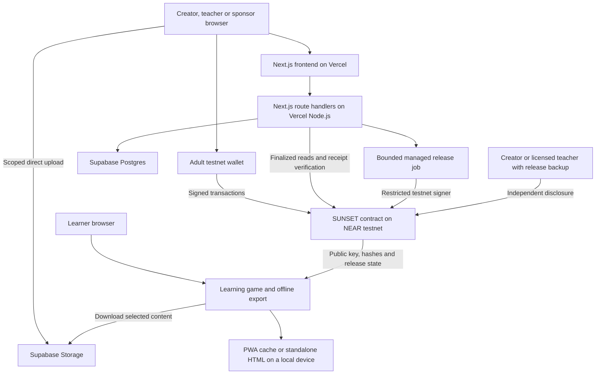

# SUNSET architecture

> Historical full design, prepared 22 October. The 1 November council replaced pending-order sales with immediate sponsorship and reduced the initial integration scope. See [the current implementation README](README.md) and [build ledger](docs/BUILD_LEDGER.md) for what is implemented and verified; this document is not a completion claim.

SUNSET turns payments for useful digital resources into a defined creator buyout and public release. Its first application is a small learning game: adult institutions or sponsors fund an original educational pack; learners can use sponsored copies; a completed buyout releases that version for everyone. Separate access grants can pay a named provider for approved delivery or support.

The user's constraints are controlling: initial provider cost must be zero, frontend and application backend should run on Vercel, the database should have a useful free tier, and settlement should use NEAR testnet. This design uses one Next.js application, Supabase and one native-NEAR contract. [Free deployment constraints](OPERATIONS.md).

## Product scope

The complete first workflow includes creator drafts, original content upload, adult review, a frozen release agreement, testnet purchases, delivery and acceptance, capped funding, key publication, creator withdrawal, refunds, public download, offline play and a finite sponsored service budget.

The first game is a small maths puzzle loop with a visible objective, immediate feedback and a replayable set of questions. One short original content pack exercises the release mechanism. A free introductory level works immediately. This establishes a playable product without requiring an open-world engine, streaming video or a GPU service.

Learners neither pay real money nor need wallets. Adult operators use faucet-funded testnet accounts. Displays label all payments as testnet demonstrations. There is no claim of a real school deployment, improved learning outcomes or an existing African partner. A field application starts with a local educator choosing language, curriculum, accessibility and delivery requirements.

Kolibri already provides an open offline platform and supports custom educational resources. A later deployment can package suitable content for it; that compatibility must be tested. SUNSET contributes the funding and release agreement and service budget. [Learning Equality](https://learningequality.org/kolibri/about-kolibri/).

## System map

## Component decisions

| Component | Decision and responsibility |
| --- | --- |
| Web application | Next.js App Router, React, TypeScript. The same Vercel deployment serves pages and route handlers. |
| API runtime | Default Node.js on Fluid Compute. Ordinary requests target completion within 15 seconds; reconciliation slices within 20 seconds. There is no permanently running process. |
| Database | Supabase Postgres via its HTTPS Data API from server code. SQL constraints and narrowly scoped database functions handle nonce consumption, job leasing and idempotency. |
| Files | Supabase Storage holds public ciphertext, public manifests, approved thumbnails and released download bundles. Large file bytes bypass API handlers. |
| Contract | Rust with `near-sdk`, native testnet NEAR only. Integer accounting, reservations, release commitments, refunds and access grants. |
| Browser wallet | `@hot-labs/near-connect`, as used in the current NEAR wallet-login guide. Filter for testnet message and transaction signing, then test an actual wallet before building the UI around it. |
| Chain client | `near-api-js` for supported RPC and transaction operations. Pin versions and read their actual APIs when implementation begins. |
| Offline runtime | Our small data-driven learning engine. PWA installation is optional; a self-contained HTML export provides an independent offline demonstration. |
| Automation | A database-backed release job processed by bounded requests. No queue, recurring paid worker or sub-minute cron is required. |

Supabase is selected over Turso for this build because it provides both relational storage and object uploads under one free service. Turso remains a valid SQLite alternative, but would require a separate file-storage decision here. The actual Marketplace discovery lists both providers. [Source record](sources.json).

No product dependencies are installed as part of this architecture task. Exact compatible framework and SDK versions will be pinned when development starts; examples copied from documentation are not assumed to match those future installed versions.

The connector follows [NEAR's current wallet-login documentation](https://docs.near.org/web3-apps/tutorials/wallet-login). Its wallet manifest and tested capabilities belong in the dependency record; backend signature verification remains independent of a wallet's claimed login success.

## Responsibility and authority

The contract is authoritative for money, reservations, beneficiaries, agreement hashes, deadlines, accepted orders and release state. Database rows are projections or application metadata. A database administrator changing a displayed total must not change spendable funds or the release condition.

Supabase holds editable descriptions, drafts, adult sessions, artifact locations, work receipts and synchronization state. It does not hold learner identities or learning histories. Child progress stays on the device by default. A teacher may export a local report; uploading it is outside the first workflow.

The browser performs content preparation, hashing, encryption, decryption, the game loop and offline export. The Vercel API authenticates adults, validates data, authorizes scoped uploads, checks chain state and processes small jobs. Testnet wallets sign all sponsor, creator and reviewer financial decisions.

An optional backend signer can call only the configured testnet contract's `publish_release` method with zero attached deposit. It has no full-access account key and cannot call withdrawals or change project terms. The contract itself fixes the creator beneficiary. The signer is a convenience, not a condition of refund access.

## Content and release keys

Each pack is a schema-validated data bundle, limited initially to 5 MiB. It contains question templates, answer data, explanatory text and approved static images. It cannot contain uploaded JavaScript, executable HTML, arbitrary remote URLs or scripts. The game engine is application code that we review and publish separately.

The creator's browser generates a random 32-byte content encryption key, encrypts the pack with AES-256-GCM and computes hashes of the plaintext, complete ciphertext and license document. Every encryption uses a fresh nonce. The fixed envelope format includes its nonce and authentication tag. The key commitment uses a fixed, domain-separated encoding that the browser and contract must implement identically.

The agreement records a bounded public manifest URI, manifest hash, plaintext hash, ciphertext hash, key commitment and license hash. The manifest includes format version, byte size, declared release terms, runtime requirements and asset references. It contains no private decryption key. The onchain pointer allows discovery without a database catalog, subject to the file remaining available. A SHA-256 value binds bytes; it does not establish ownership, educational quality or safe content.

Before launch, a named adult reviewer decrypts the exact uploaded ciphertext, checks the resulting hash and uses the game. Their onchain approval binds to that complete agreement. This is a disclosed reviewer trust assumption. It is not a cryptographic proof that every lesson is good or that the creator owns all rights.

For managed delivery, the creator may send the content key over HTTPS to the Vercel backend. It is stored encrypted under a server-side key-encryption key, with project and artifact identity bound into the encryption. The key-encryption key is an environment secret, not a public client variable. Logs never contain plaintext keys, private signer material or signed upload tokens.

The creator also retains a local release backup. A licensed school administrator who receives the pack can download a release backup containing the content key, agreement identity and independent contract-call instructions. They keep it on their own device. This makes buyer-assisted release possible without requiring paid confidential execution.

Authorized recipients and the application operator can copy or disclose this content early. Encryption protects storage and limits casual access; it does not provide DRM against people who legitimately receive the pack. They already receive reusable bytes for offline use. The open license is a separate part of the public-release agreement.

## Managed release and independent release

After finalized funding, a request enqueues one release job for the agreement. A processor leases it, reads fresh contract state, checks the code and agreement identity, decrypts the stored key and submits `publish_release`. The contract accepts only the committed key for a funded, unexpired agreement and credits the fixed creator beneficiary. A repeated attempt cannot pay twice.

The browser reconciles pending state with bounded retries. A daily cron may retry unattended work, but no deadline or refund depends on cron running. Vercel Hobby cron is not a precise, frequent scheduler. [Cron limits](https://vercel.com/docs/cron-jobs/usage-and-pricing).

If the backend is unavailable, the creator or a licensed teacher can publish the committed key directly using their own wallet and release backup. They cannot redirect the creator's payment. The backend is not needed to call the contract's refund or withdrawal methods either.

If nobody retains a usable key or completes disclosure by the deadline, contributors can claim the contract-defined refund. Losing every key is not recoverable by a hash. The enforceable guarantee is release or refund, with explicit key-holder and network availability assumptions.

Published keys and agreement hashes remain accessible from NEAR. Ciphertext must also remain available: content-addressed paths, downloaded copies and optional mirrors protect against dependence on one store. An object-store administrator can still delete a hosted copy. The offline demonstration must therefore use previously exported copies, rather than merely hide the original website's navigation.

## Offline use

The free introductory game needs no wallet. A teacher with a sponsored license can distribute the agreed pack to the authorized learning group before global release. After release, any visitor can retrieve the public key, verify the pack and use the granted rights.

The online application lets a user download a selected module. A service worker caches only the reviewed game shell and chosen content. It does not cache adult session responses, private API endpoints or wallet callbacks. Cached progress is local, and the UI explains that browser storage can be cleared or evicted.

The independent export is a self-contained HTML file containing the reviewed runtime and the selected content as safely encoded data. It performs no network requests and requires no browser wallet, API credential or live server. Its basic game works from a local file; progress export is explicit because local-file storage behavior differs between browsers.

A classroom LAN hub is a later deployment mode. A cached browser tab does not itself become a school server. Existing offline learning systems show why devices, networking and teacher support remain separate delivery work. [UNICEF offline model](https://www.unicef.org/learningpassport/offline-learning).

## Access grants and greater-good applications

Asset buyout money and access grants are separate. A sponsor can create a finite grant for a named provider and named adult approver, with a unit price, maximum amount and expiry. The approver accepts a documented service delivery; the contract credits the provider within the funded cap. Unused funds become refundable to the sponsor after expiry.

This can demonstrate paying for a deployment check, a teacher support session or a defined period of hosting. A signed approval proves who accepted the claim. It does not prove that children learned, that hardware reached a school or that the claimed service occurred. Initial evidence is supplied by named adults; a real pilot needs a local delivery partner and appropriate evaluation.

Later, the same agreement pattern could release an original learning game, an accessibility resource or a game-server distribution the rights holder controls. Cloud gaming and public game servers still require recurring hardware, electricity and bandwidth. Vercel hosts SUNSET's control application; it is not budgeted here as a GPU or permanent game-server fleet. A later provider integration would buy a finite quoted service period.

## AI and track claims

The core lifecycle is fully functional without a paid model. Teachers review the content; no generated lesson is automatically certified. A future optional adult-side assistant can draft content or compare provider offers using a local model or a deliberately configured provider. Unavailable inference must not break learning, payments, refunds or release.

Browser or local policy agents may exercise independently authorized testnet budgets in the demo. Deterministic software agents are not automatically an AI Swarms entry. Open Innovation is the core track; Autonomous Business, Agent Economy, AI Swarms or Social Money require the actual corresponding behavior and integrations before being claimed.

## Explicit boundaries for the first build

There is one asset format, one learning game, one native asset, one network, one application deployment and one database provider. No required paid AI, TEE, managed queue, custom domain, blockchain indexer subscription or mainnet bridge is introduced. NEAR Intents is outside this testnet design.

User funds can be affected only by authenticated contract transitions. Active agreements cannot be edited by a database operation. Development deployments remain visibly upgradeable; a final immutable testnet demonstration needs a separately verified deployment with no upgrade or key-restoration path. [Contract specification](CONTRACT.md).

The remaining implementation proofs are explicit: wallet signing compatibility, cross-language hash agreement, correct cap reservations, asynchronous withdrawal behavior, independent key disclosure, source-to-binary identity, and offline export on an actual browser. They are acceptance criteria in [operations](OPERATIONS.md), not claims already established by this design.
