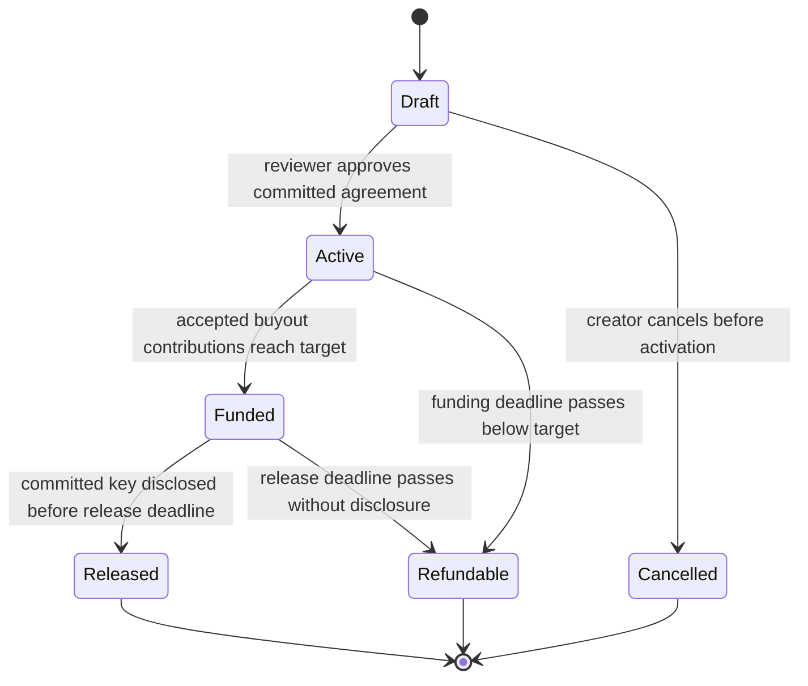

# SUNSET contract specification

> Historical full design, prepared 22 October. The 1 November council replaced pending-order sales with immediate sponsorship and reduced the initial integration scope. See [the current implementation README](README.md) and [build ledger](docs/BUILD_LEDGER.md) for what is implemented and verified; this document is not a completion claim.

One versioned Rust contract owns the prototype's native-NEAR ledger on testnet. A campaign, order, release and access grant are separate records inside that contract. No API response, SQL row or agent judgment can transfer escrow by itself.

This is the intended specification for implementation and tests. There is no deployed contract address yet. `SUNSET_CONTRACT_ID` will contain the actual account after a testnet deployment; an example address is not treated as an existing resource.

## Agreement and actors

An agreement contains a unique campaign ID, creator beneficiary, operator beneficiary, reviewer account, bounded public manifest URI, manifest hash, plaintext hash, ciphertext hash, content-key commitment, license hash, buyout target, order price split, funding deadline and release duration. All account identities belong to the selected network. The URI is a download pointer, not proof of availability; all downloaded bytes must match their committed hashes.

The contract computes an agreement digest from its versioned typed immutable fields. Review and client actions bind to that digest. The manifest is hashed as its exact uploaded UTF-8 bytes; clients do not silently reserialize it before checking the hash.

The creator registers the terms. The named reviewer approves the exact terms and artifact. A buyer funds and accepts an order. `licensed_to` is an adult account selected by the buyer, such as a school administrator; it does not change the buyer's refund beneficiary. An independent key holder may complete disclosure. An access-grant approver has authority over only their named grant.

Onchain authorization uses the actual caller account. An application's authenticated session is not contract authority. All beneficiary accounts are fixed by the relevant agreement or grant; publishing a key does not earn the publisher the creator's money.

## Campaign states

Time is evaluated using the chain timestamp. A view derives the effective state when a deadline has passed, even if nobody has sent a transition transaction. Mutating methods perform the corresponding checks or materialization. There is no assumption that a contract wakes itself up at a wall-clock time.

The funding deadline is exclusive for new or accepted orders: `now < funding_deadline`. Each order's acceptance deadline is no later than the funding deadline. Release must satisfy `now < funded_at + release_duration`. At equality, the relevant expired path applies. This avoids a race where release and refund are both legal at the boundary.

Released and Refundable are mutually exclusive terminal economic outcomes. A contributor withdrawing a refund cannot reactivate a campaign. A cancelled draft cannot have accepted order deposits.

## Money representation and reservations

All amounts are integer yoctoNEAR in `u128`. JSON sends them as decimal strings; JavaScript uses `BigInt`. Every sum, product and subtraction uses checked arithmetic and rejects overflow or underflow. Unit counts and collection sizes have explicit bounds. No floating point or fiat conversion participates in contract arithmetic.

For the demonstration, a full-price order has 0.2 testnet NEAR for service and at most 0.8 toward an 8-NEAR buyout. These are configurable, immutable example terms. Service revenue, buyout contributions and access grants occupy different balances.

When opening an order, the contract computes the available buyout amount from both settled and reserved contributions. It reserves at most the remaining target. A partial final contribution lowers the actual order price, and unused authorized payment becomes the buyer's claimable change. It is not silently added to operator fees. If all remaining capacity is reserved by pending orders, a new buyout order is rejected until capacity is accepted or released; the UI can show a pending-capacity message.

The invariant is:

`settled_buyout_total + reserved_buyout_total <= buyout_target`

An order deposit remains pending until buyer acceptance. Acceptance credits the operator's service portion, moves the reserved buyout portion into buyout escrow and records that buyer's contribution. A repeated acceptance cannot create a second credit. The final accepted contribution records `funded_at`.

An expired unaccepted order returns both portions to the buyer's claimable balance and releases its reservation, even if the campaign has otherwise reached its target. Before acceptance the operator bears the risk of a buyer receiving a copy and refusing acceptance. That is an explicit prototype delivery policy, not a solved fair-exchange protocol.

Storage charges are separate from economic prices. Calls that create records attach a bounded storage allowance; the contract charges actual growth at the protocol storage price and credits unused allowance back to its owner. Refund records, the fixed public-key slot and withdrawal status slots are allocated before they are needed. Release therefore needs no attached storage deposit and can use a restricted function-call key. Storage is not counted toward the buyout. The UI must show storage and transaction gas separately.

## Intended public methods

| Method | Caller and effect |
| --- | --- |
| `create_campaign(terms, client_id)` | Creator; creates a draft and funds its actual record storage. |
| `approve_campaign(id, agreement_digest)` | Named reviewer; freezes the exact agreement and activates funding. |
| `cancel_draft(id)` | Creator; permitted only before activation and before orders exist. |
| `open_order(id, order_id, licensed_to, max_payment, acceptance_deadline)` | Buyer; deposits a bounded price plus storage, reserves capacity, records fixed beneficiaries. |
| `accept_order(order_id, plaintext_hash)` | Buyer; acknowledges delivery of the committed pack and settles the pending order once. |
| `cancel_expired_order(order_id)` | Any caller; after expiry, credits the original buyer and frees the reservation. |
| `publish_release(id, raw_key)` | Any key holder; validates state and commitment, stores the public key and credits the fixed creator. |
| `claim_buyout_refund(id)` | Contributing buyer; after the campaign's refundable outcome, credits their unrefunded settled contribution. |
| `create_access_grant(grant_terms, client_id)` | Sponsor; deposits a separate service budget with provider, approver, unit price and expiry. |
| `approve_service(grant_id, claim_id, units, evidence_hash)` | Grant's adult approver; credits the fixed provider within the remaining budget before expiry. |
| `refund_unused_grant(grant_id)` | Sponsor or another caller; after expiry credits the remaining amount to the fixed sponsor. |
| `withdraw(amount)` | Credit owner; begins an asynchronous native-NEAR withdrawal to their own account. |
| `on_withdraw_complete(operation_id)` | Private callback; finalizes the recorded result of that withdrawal. |

Read methods return campaign summaries, immutable terms, public release data, orders, contributions, access grants, balances and paginated record IDs. These make balances and entitlements recoverable without the database. Pages are bounded, initially at 20 records. Monetary records include the schema version and relevant identities.

Opaque client IDs and claim IDs have fixed length limits. The same ID with different intent is rejected. Repeating a deposit-bearing create call is rejected rather than silently accepting another deposit. Repeating a completed nonpayable settlement with the same intent returns its existing result or a harmless already-complete outcome. Receipt handling must distinguish that from a failed transaction.

## Delivery and public disclosure

An order buys an agreed license to a pre-existing reviewed pack. It is not a promise that an LLM will invent an acceptable lesson later. The backend grants download access to the buyer or fixed adult licensee of a current pending or accepted order. Buyer acceptance is a signed acknowledgment; the contract cannot detect a physical download or assess a child's learning.

The key commitment is `SHA256(UTF8("SUNSET:KEY:1:") || key_bytes)`, where `key_bytes` is exactly 32 bytes. The committed plaintext and ciphertext hashes separately bind the artifact. A reviewer checks before launch that the key decrypts that ciphertext to the stated plaintext. The contract checks the key commitment at release; it does not implement AES decryption or evaluate the content. A dishonest or mistaken reviewer remains a stated trust assumption.

The JSON wire format carries the key as a base64 string decoded into exactly 32 bytes, matching `Base64VecU8`-style handling. Hash the decoded bytes with the domain prefix, never the textual base64 representation. Fixed public test vectors must agree between Rust, browser crypto and the backend before activation is enabled.

Disclosure writes the key and credits the entire buyout escrow to the creator in the same contract execution. It schedules no creator transfer yet; the creator withdraws their credited balance separately. Anyone can disclose the key, including a teacher using a saved release backup. No publisher-selected payout address is accepted.

Keys must never be submitted in a premature test transaction: even a rejected transaction can expose its input. Authorizations and runtime checks do not make transaction arguments private. An early offchain leak is possible from any authorized key holder and is outside the financial invariant.

After successful release, additional buyout orders are disabled. Any continued paid service is a new explicit service-only operation or a new access grant. It cannot refill or reset the completed version's buyout. A new version requires a new campaign with different artifact identity.

## Refunds and withdrawals

When an underfunded campaign expires or a funded campaign misses disclosure, settled buyout contributions become individually refundable. Accepted service fees stay earned. Pending orders follow their own full-refund rule. A contribution cannot be both paid to the creator and refunded.

Refund methods create withdrawable credits rather than push payments in a loop. This bounds gas and lets each actor recover independently. There is no need for an organizer, cron or Vercel API to authorize an eligible refund.

`withdraw` moves an amount from credit to a single pending operation for that owner before creating the transfer promise. A private callback moves it to paid-out status on success or returns it to credit on confirmed failure. A retry cannot spend an operation that is still pending. The call reserves callback gas and requires sufficient prepaid gas before committing state.

NEAR receipts execute independently. If the callback itself fails, the operation remains pending and must not be blindly recredited or paid again. The implementation must keep the callback bounded with preallocated state, test both transfer failure and callback failure, and provide a diagnostic receipt reference. Any recovery that changes money must be based on a verifiable result; an administrator's guess is insufficient. [NEAR asynchronous behavior](https://docs.near.org/smart-contracts/anatomy/crosscontract).

Economic accounting is checked separately from storage and gas:

`economic deposits = pending order balances + buyout escrow + unspent grant balances + withdrawable credits + withdrawals in flight + successful withdrawals`

Moving money between these categories must conserve value. Unsolicited direct transfers to the contract are unallocated surplus, not buyout revenue. Storage collateral cannot be distributed as creator compensation. Runtime balance and reserved-promise checks must be exercised in the actual Sandbox implementation.

## Sponsored access grants

Each grant has one sponsor, one provider, one approver, a unit price, a cap, expiry and an immutable purpose hash. Multiple sponsors create separate grants, which avoids ambiguous proportional refund accounting in the first build.

An approval binds the grant, unit count, claim ID and evidence hash. Units cannot be negative or exceed remaining funded capacity. Exact duplicate claims have one economic effect. At expiry, no new service approval is accepted and unused credit returns to the original sponsor. Provider fees already approved remain earned.

The contract proves who approved spending and that it stayed within its cap. It does not prove attendance, lesson quality, device delivery or real hosting uptime. The prototype uses adult test accounts and clearly labeled demonstration evidence.

## Contract deployment policy

During development, deployments are visibly marked upgradeable. Existing active terms still have no edit method, but a retained full-access deployment key means the code could be replaced. The application must not label that deployment immutable.

For the final stronger testnet demonstration, verify a separate contract deployment with no upgrade method, arbitrary transfer method or key-restoration route, and remove its external full-access control only after tests and recovery instructions pass. Removing keys is not itself proof if the code can restore them. [NEAR locked accounts](https://docs.near.org/protocol/accounts-contracts/access-keys).

Frontend configuration pins network, contract identity and reviewed code hash. New contract versions get new identities; the database cannot migrate old escrow. Mainnet deployment, other assets and confidential execution require a later design and review.
