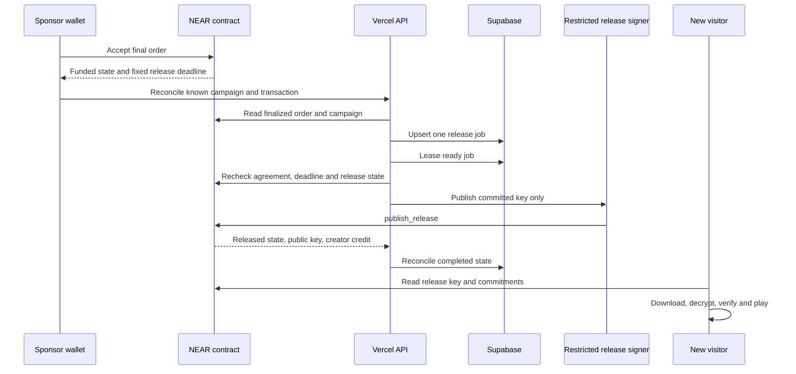

# SUNSET end to end workflows

> Historical full design, prepared 22 October. The 1 November council replaced pending-order sales with immediate sponsorship and reduced the initial integration scope. See [the current implementation README](README.md) and [build ledger](docs/BUILD_LEDGER.md) for what is implemented and verified; this document is not a completion claim.

The learner experience is a free browser learning game. The adult experience manages content, testnet funding, release and service budgets. Every financial state shown by the application has a corresponding contract record; the database is not an alternative balance ledger.

## 1. Visit and learn immediately

A visitor opens the free introductory game and plays a short puzzle loop. They choose a local display label if needed; no name, age, email, wallet or cloud profile is required. The browser holds progress locally. Losing browser data can lose that progress, so an explicit export is available.

The catalog explains which additional packs have sponsored access and which have completed public release. Testnet funding is clearly labeled. A campaign's projected description may load from Postgres, but its economic badge uses a finalized contract view with a timestamp. If verification fails, the last observed total is labeled stale and new economic actions are disabled.

## 2. Adult wallet authentication

1. The creator, teacher or sponsor selects a tested testnet wallet. Unsupported signing capabilities produce a clear explanation rather than a silently weaker login.
2. The backend creates a five-minute, single-use challenge with a random 32-byte nonce, expected origin, recipient, network and account identity.
3. The wallet signs the NEP-413 message. Browser-wallet redirects preserve a validated callback URL and anti-forgery state.
4. The backend verifies the exact message, recipient, nonce, expiry and signature, then checks that the key currently belongs to the account on testnet. The first implementation accepts supported full-access Ed25519 wallet keys for adult login; a restricted application key is not silently accepted as unrestricted account authority.
5. A SQL transaction consumes the challenge once and creates an opaque session. The cookie is secure, HTTP-only, same-site and scoped to the application. Only the token hash is stored; session expiry is twelve hours. Privileged actions revalidate current wallet authority as needed.

This session permits application edits and scoped downloads. Contract calls still need wallet signatures. No recovery phrase or full-access wallet key is requested. The connector is NEAR Connect, following [the current official guide](https://docs.near.org/web3-apps/tutorials/wallet-login). Use cryptographically random 32-byte nonce data; a textual UUID is not a substitute for the required nonce format. The [Wallet Selector message-signing reference](https://github.com/near/wallet-selector/blob/main/packages/core/docs/api/wallet.md) is additional interface context, not the chosen connector.

## 3. Prepare an original learning pack

The creator edits a draft with title, sample, rights declaration, adult reviewer, payout accounts, funding target, split and deadlines. In the browser they prepare the schema-limited pack, run the learning game, encrypt it and generate the manifest and hashes described in [the architecture](ARCHITECTURE.md).

The API authorizes a storage object path under that creator and artifact hash. The browser uploads directly to Storage using a scoped signed upload token with overwrite disabled. The provider's documented token validity is two hours; it is not assumed to be five minutes. A strict bucket size limit, upload-count limit and content-addressed path apply. [Signed upload URLs](https://supabase.com/docs/reference/javascript/storage-from-createsigneduploadurl).

A finalize request checks that the expected object exists, is within the limit and has the committed ciphertext hash. It does not fetch arbitrary user-supplied URLs. Approved files are not overwritten in place. The encrypted key is stored separately for managed service delivery, and the creator downloads a release backup before activating the agreement.

Content and API schemas reject uploaded scripts, unsafe paths, malformed question definitions and unbounded structures. A committed hash is not an exemption from those checks. Hosted pack data is rendered as data, never evaluated as code.

## 4. Review and freeze the agreement

The creator prepares and signs `create_campaign` in their wallet. The backend reconciles the resulting finalized contract record and pins its agreement digest in the application.

The named adult reviewer receives the pack and key through the licensed review path. They download the same ciphertext, decrypt it, verify all hashes and check the game, samples and stated rights. They download an independent release backup. Their wallet signs `approve_campaign` for the exact onchain digest.

The API observes activation and stops offering edits to economic or artifact terms. A changed description cannot change the manifest or agreement. A changed asset needs a new version and campaign. If the database and chain disagree, the UI displays the chain's committed terms and blocks publication until reconciled.

## 5. A sponsor buys a school license

For this first application, an order purchases a defined license to the existing reviewed pack. A sponsor can set `licensed_to` to a school administrator's adult testnet account. There is no personal account for each child.

The UI retrieves a fresh quote and shows the service portion, buyout portion, storage allowance, gas and expiry. The sponsor signs `open_order`. The contract reserves available buyout capacity, credits excess authorized payment as change and returns the canonical order ID.

The application verifies the actual contract order. The buyer or fixed adult licensee can obtain the ciphertext, content key, license notice and local-use bundle. An active pending order is enough to allow this pre-acceptance delivery. If a download fails, the request can be repeated without creating another order.

After inspecting delivery, the sponsor signs `accept_order` for the committed artifact. The contract credits service fees and the buyout contribution once. In a school workflow the adult teacher can confirm delivery to the sponsor through a work receipt, but that receipt cannot spend the sponsor's funds by itself.

If the buyer never accepts, the order expires and its payment becomes refundable under the agreed rule. Receipt delivery does not prove educational quality; buyer refusal after downloading remains an explicit commercial limitation of this prototype.

## 6. Funding completes and release is processed

The transaction returned by a wallet is an observation to verify, not proof of success. The API checks finality, intended receiver, method, caller and the actual contract outcome, including relevant receipts. It then confirms the resulting campaign or order view. A top-level transaction status alone is not sufficient for asynchronous effects.

One release job is keyed by network, contract, campaign and agreement digest. Processing uses a short SQL lease. Before resubmission after a timeout, it reads the contract: a transaction may have succeeded even if its HTTP response was lost. Jobs have bounded attempts, recorded next-attempt time and a diagnosable failure state. There is no infinite in-request retry loop.

A creator or licensed reviewer can also publish using their local release backup and own wallet. A downloadable recovery guide identifies the actual network, contract, campaign and committed hashes. This route works without API sessions or a healthy database. The key holder must still have access to a functioning testnet endpoint.

The backup contains the content key and artifact pointers, not a wallet's signing key. Independent disclosure uses a tested direct CLI/wallet procedure with the caller's own account. This procedure must be exercised during the demo; a locally saved backup alone does not demonstrate that the caller can submit a transaction.

## 7. A new visitor receives the public resource

The public page reads the released key and terms from the contract. It downloads the committed ciphertext directly from Storage or a supplied matching mirror, verifies the ciphertext hash, decrypts and checks the plaintext hash. A mismatched file produces a failure, not an “open” badge.

The visitor can play online, cache that module or export the reviewed offline HTML runtime with the content embedded as safely encoded data. The exported file makes no API, storage, wallet or inference requests. The demonstration closes the Vercel app and disconnects the test device before reopening that export.

Global reuse applies to the agreed version and granted rights. New versions may have new campaigns, while the released version remains usable. An asset does not become reliably preserved merely because a page links to it: retain downloadable copies and backup locations.

## 8. Fund a finite access service

A sponsor creates an access grant for one named adult provider and approver, defining the service, unit price, cap and expiry. It is separate from buying the pack. A teacher support session or local deployment check is an appropriate demonstration service.

The provider records a small evidence document in the application. The approver checks it and signs `approve_service` with its hash and unique claim ID. The contract validates authority and budget and creates provider credit. At expiry, unused grant funds become refundable to the fixed sponsor.

The UI distinguishes pledged funding, approved spending, service evidence and independently measured results. A signed receipt does not establish attendance or improved learning. No children’s records are required for the demonstration. Offline copies continue working when a grant runs out; future human support or hosting needs renewed funding.

## 9. Refund and withdraw

For an expired unaccepted order, an underfunded expired campaign, a missed release or an unused expired grant, the UI shows the applicable refund action. The actor signs the corresponding contract call. Their credit can then be withdrawn, with pending and completed transfer states shown separately.

A duplicate click, repeated reconciliation request or page refresh cannot create a second credit or withdrawal. The database may lag behind the receipt; it is refreshed from the contract instead of offering a second payment. If the whole website fails, the recovery guide permits direct contract calls.

## API boundaries

All paths below are design interfaces inside the one Next.js application. Mutating API requests validate origin, session, actor ownership, body size and rate limit. Contract preparation returns explicit call data for a wallet; it does not bypass wallet consent.

| API group | Endpoints and responsibility |
| --- | --- |
| Authentication | `POST /api/auth/challenge`, `POST /api/auth/verify`, `POST /api/auth/logout` |
| Catalog | `GET /api/projects`, `GET /api/projects/{id}`; cached metadata with labeled chain observation |
| Drafts | `POST /api/projects`, `PATCH /api/projects/{id}`; owner-only draft fields |
| Files | `POST /api/projects/{id}/uploads`, `POST /api/projects/{id}/artifacts/finalize`; scoped upload authorization and verification |
| Agreements | `GET /api/projects/{id}/agreement`; exact immutable onchain terms and matching manifest |
| Quotes | `GET /api/projects/{id}/quote`; advisory current price, expiry and storage estimate; contract rechecks |
| Licensed delivery | `POST /api/orders/{id}/download-access`; checks the canonical buyer or adult licensee and order status |
| Reconciliation | `POST /api/chain/reconcile`; accepts only known IDs or bounded transaction references and verifies them |
| Release | `POST /api/projects/{id}/release/process`; processes one leased job after fresh contract checks |
| Public download | `GET /api/projects/{id}/release`; public pointers and contract key after confirmed release |
| Access work | `POST /api/grants/{id}/claims`; stores a provider's evidence and prepares an approver's wallet action |
| Maintenance | `GET /api/health`, `GET /api/maintenance/daily`; health checks and authenticated, bounded daily work |

This is not a general JSON-RPC proxy, arbitrary URL fetcher, free file-hosting endpoint or arbitrary transaction signer. Financial writes use the user's wallet except the strictly restricted release convenience.

## Database model

| Table | Important fields and constraints |
| --- | --- |
| `adult_accounts` | Composite network/account identity; optional display name; no learner profiles |
| `auth_challenges` | Nonce hash, exact message context, account, expiry, consumed time; single consumption |
| `sessions` | Token hash, adult identity, expiry, revocation time |
| `projects` | Creator, draft metadata, selected contract/campaign, committed digest, catalog visibility |
| `artifact_versions` | Manifest, hashes, size, object paths, encrypted key envelope, key-encryption version; unique artifact hash |
| `orders` | Unique network/contract/order identity, buyer, adult licensee, monetary values as validated decimal text, status and observed block |
| `access_grants` | Unique chain grant identity, sponsor, provider, approver, balance projection, expiry |
| `service_claims` | Grant, unique claim ID, provider evidence pointer/hash, approval receipt; no child-level evidence |
| `chain_observations` | Unique receipt/log identity where available, verified contract, block, decoded record references and payload |
| `release_jobs` | Unique agreement key, status, lease expiry, attempts, transaction reference, next attempt and redacted error |
| `audit_events` | Adult action, object identity, time and non-sensitive result |
| `rate_limits` | Salted short-lived request bucket, count and expiry; never in-process-only enforcement |

All application tables deny unauthenticated direct reads and writes unless a specific public read view is required. Backend credentials remain server-only. A privileged service credential can bypass RLS, so every API path still performs explicit authorization. Learners do not receive that credential or database access. Uploaded content uses an explicit Storage policy and narrow signed token. [Storage access controls](https://supabase.com/docs/guides/storage/security/access-control).

SQL functions used for challenge consumption and job leases run atomically and have narrowly granted execution permissions. Unique indexes enforce idempotency even when two Function instances race. Sessions and challenge routes are not cached. Supabase Auth, Realtime and Edge Functions are not required by this first architecture.

Monetary projection columns use decimal text with a digits-only constraint and explicit `u128` range validation. This avoids a database SDK parsing a large JSON numeric value into an imprecise JavaScript number. The API preserves decimal strings end to end and converts to `BigInt` for checks. It applies the same rule to nanosecond timestamps and other chain integers outside JavaScript's safe range. Database projections perform no authoritative financial settlement.

## Synchronization and recovery

After wallet mutations, the client asks the API to reconcile only the affected IDs. A visible pending page polls with backoff for a bounded period, then offers refresh rather than issuing a new financial action. Inactive tabs stop polling. Public catalog pages use short shared caching and do not fan out one RPC query per card on every visit.

The contract exposes bounded pagination of campaigns, orders and grants. A manual rebuild command can reconstruct economic projections from these views; it does not rely on a paid historical indexer. Draft descriptions and encrypted key envelopes still need database backups, and artifact bytes need storage backups. Economic state alone cannot reconstruct deleted educational content.

RPC providers and object stores remain trusted availability and transport dependencies in the prototype. If endpoints disagree on finalized state or the expected network/code hash does not match, the API stops release processing and asks for a later retry. It does not choose the most financially convenient response.
